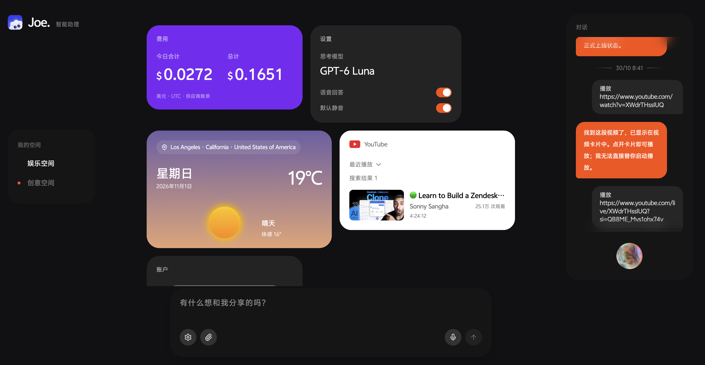

# Joe

本地单用户 AI 助手，支持文字与语音对话、卡片画布和截图记账。



[观看演示视频](docs/media/demo.mp4) · 35 秒

## 启动

需要 Bun 1.3.14+ 和 Node.js 22.13+（推荐 Node.js 24）。

```sh
bun install
cp backend/.env.example backend/.env
```

在 `backend/.env` 填写 `OPENROUTER_API_TOKEN`，按需配置语音、天气和视频数据服务。配置项见 [环境变量示例](backend/.env.example)，对话、决策与图片识别模型见 [模型配置](backend/src/config/models.ts)。凭据只保存在后端。

```sh
bun run dev
```

打开 <http://127.0.0.1:5173/joe>，根路径也会跳转到此页面。后端运行在 `127.0.0.1:4111`。独立启动命令见 [根目录脚本](package.json)。

## 功能

- **对话**：流式回答、图片和文本附件、语音输入与播报；会话保存在本地。
- **画布**：两个空间，自由与 Bento 布局，卡片拖动、展开和收起。
- **记账**：添加图片，输入 `/tally` 后发送，识别账户与余额；支持银行卡、信用卡和支付宝余额宝，保留余额历史。未展开时隐藏金额。
- **天气**：按客户端公网 IP 或指定城市查询当前天气。
- **视频**：通过独立数据服务搜索 YouTube，卡片内播放并记录观看进度。
- **费用**：查看模型用量与费用，以及已配置语音供应商的账户数据。

图片识别会将原图发送至 OpenRouter 对应模型服务。视频数据服务需独立安装 Agent Reach，Python 依赖和启动入口见 [requirements.txt](services/data-mcp/requirements.txt) 与 [server.py](services/data-mcp/server.py)。

## 代码与文档

实现细节以代码为准；协议与设计说明见对应文档。

| 内容 | 入口 |
| --- | --- |
| 领域词汇 | [CONTEXT.md](CONTEXT.md) |
| Web 画布与交互 | [web/src/joe](web/src/joe) |
| Agent、语音与本地存储 | [backend/src/joe](backend/src/joe) |
| 账户识别与余额存储 | [识别流程](backend/src/joe/tally.ts)、[账户存储](backend/src/joe/finance-store.ts) |
| 卡片实例与数据绑定 | [卡片协议](docs/widget-protocol.md) |
| 画布编辑 | [编辑协议](docs/canvas-edit-protocol.md) |
| 视频行为记录 | [行为文档](docs/widget-behavior/index.md) |
| Mastra 集成 | [能力审查](docs/mastra-capability-audit.md) |

## 检查与部署

```sh
bun run test
bun run typecheck
bun run build
```

数据默认保存在 `backend/data`，可用 `JOE_DATA_DIR` 修改。备份需包含 `joe.sqlite`、`mastra.db` 及其 WAL 文件，或停服后备份整个目录。

当前用于本地单用户环境。部署时需将 `/joe-api/*` 同源代理至后端并关闭流缓冲；端口、Origin 与数据目录配置见 [服务配置](backend/src/joe/config.ts) 和 [HTTP 边界](backend/src/joe/routes.ts)。构建与启动命令见 [Web 脚本](web/package.json) 和 [后端脚本](backend/package.json)。

## 致谢

界面使用 [Rare UI](https://www.rareui.com/)。光球包含 [OrbKit SHDR-01](https://orbkit.zzzzshawn.cloud/) 着色器，由 [XorDev](https://x.com/XorDev) 创作、zzzzshawn 移植，仅限非商业使用并需保留署名。第三方许可见 [THIRD_PARTY_NOTICES.md](THIRD_PARTY_NOTICES.md)。
